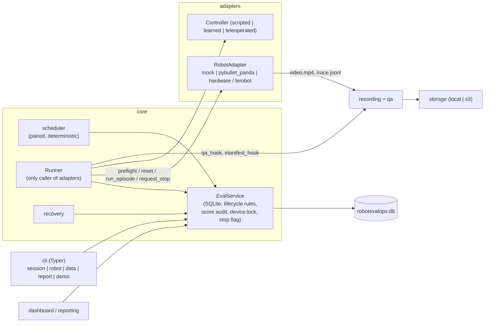

# Architecture

RobotEvalOps is a deterministic evaluation and data-QA pipeline. Claude agents *build* the software; no LLM
output ever drives robot motion. Contracts: `docs/contracts.md`. Data layout: `docs/data-schema.md`.

## Layers



ASCII view of one trial:

```
planned -> preflight -> ready -> [adapter.reset] -> running -> [adapter.run_episode] -> completed
                 |                                      |                              failed
                 +-> failed (preflight_failed)          +-> aborted (stop/operator/safety/interrupted)
```

## Boundaries

| Component | Owns | Never does |
|---|---|---|
| `core.service.EvalService` | all persistence, lifecycle validation, score protection + audit log, device lock, persisted stop request, manifest export | call adapters, touch hardware |
| `core.scheduler` | deterministic paired schedule (pure function of `EvalConfig`) | I/O |
| `core.runner.Runner` | the ONLY calls to adapters; the device lock; per-trial lifecycle; artifact hashing; forwarding stop requests | decide task success for hardware, resume after a crash |
| `core.recovery` | RUNNING -> ABORTED/`interrupted_runner`, session -> PREFLIGHT + `requires_fresh_preflight` | resume motion, mark success |
| adapters | one episode: reset, act, record, report evidence | write to the DB, take locks |
| recording / qa | video + trace files, QA flags (`qa_hook`) | change lifecycle state directly |
| storage | local/S3 transfer, checksum verification | alter evidence |
| dashboard / reporting / CLI | read and edit via `EvalService` only | open the SQLite file directly |

## Who owns device control

Exactly one runner owns a physical device at a time. `Runner.run_session` calls
`EvalService.acquire_device(device_id, session_id)` (a row in `device_locks`) before building the adapter and
releases it in a `finally` block, so an exception cannot leave the lock behind. A second runner on the same
device gets `DeviceBusyError`. After a crash, `recover` releases locks held by the recovered session.
Mock and simulation sessions need no lock.

Hardware gates, checked in this order before any trial: operator acknowledgement (`operator_ack_at`,
`HardwareRefusedError`), `requires_fresh_preflight` (`PreflightFailedError`), session READY (an explicit passing
preflight). Every trial additionally runs `adapter.preflight()`. A software stop request is a persisted flag
(`stop_requests`); the runner polls it in a watcher thread and calls `adapter.request_stop()` (idempotent). It is
NOT an emergency stop and carries no latency guarantee.

## Runner behaviour (summary)

* Termination -> state: `success_criterion_met`/`timeout` -> COMPLETED; `operator_abort`/`software_stop_request`/
  `safety_stop` -> ABORTED; `infra_failure`/`recording_failure`/`preflight_failed`, adapter `error`, or any raised
  exception -> FAILED. FAILED trials keep `task_outcome=unscored` and stay in every count and in the manifest.
* Scoring: simulation adapter `task_success` -> `physics_evidence`; mock -> `mock_fixture`; `None` (hardware) or
  imported provenance -> stays UNSCORED until an operator scores it. An adapter result that contradicts its own
  termination reason is left unscored with a note in `evidence`.
* Intervention: mock/simulation -> `none` unless the adapter detected one (`assisted`); hardware/imported ->
  `unknown` until scored. `is_autonomous_success` requires COMPLETED + success + intervention `none` + non-teleoperated
  controller + recording quality not `fail`.
* Halts: a failed preflight halts the session (PREFLIGHT, fresh preflight required). A hardware infra failure
  halts the same way. An abort/safety stop/stop request ends the session ABORTED; remaining trials stay PLANNED.
  A reset failure is recorded as RUNNING -> FAILED(`infra_failure`) because READY -> FAILED is not an allowed edge;
  the attempt therefore counts as initiated (conservative for the infra-abort rate).
* Gate refusal (VF-08): if `adapter.reset` raises `HardwareRefusedError` (hardware mode off, no acknowledgement
  bound to the adapter, ...) nothing moved and nothing was attempted. The Runner returns the trial from READY to
  PREFLIGHT (`started_at` stays unset, no termination reason), pauses the session at READY, records a
  `hardware_refused` event, releases the lock and re-raises `HardwareRefusedError`. The refusal therefore never
  appears as an infra failure or in the infra-abort rate; trials stay un-run. Design choice: no new adapter API
  is required (Robotics owns `adapters/`); the refusal is caught at the first motion-related call, which is
  before RUNNING.
* After the loop: all trials terminal -> COMPLETED; `max_trials` reached -> READY (resume later with the remaining
  PLANNED trials); stopped -> ABORTED.
* A crash never resumes: terminal trials are never re-run, and the interrupted trial stays ABORTED.

## Failure and recovery

`session recover` (or `EvalService.recover_interrupted`) is idempotent: RUNNING trials become
ABORTED/`interrupted_runner`, files in `runs/<session>/trials/<trial>/` are hashed and registered (registered but
absent files become MISSING), prior evidence is kept, `duration_s` stays unset (never measured). The session moves
RUNNING -> PREFLIGHT with `requires_fresh_preflight=true`; `mark_preflight_passed` (via `session preflight`)
clears it. A live runner in another process is indistinguishable from a dead one: stop it before recovering.
Scenario test: `core/fault_interrupted.py::run_interrupted_runner_case` (fault F10).

## Concurrency

SQLite in WAL mode, foreign keys on, `busy_timeout` 30 s. Every mutation is a `BEGIN IMMEDIATE` transaction, so
two writers (threads or processes) are serialised; e.g. two simultaneous `score_trial` calls yield exactly one
success and one `ScoreProtectionError`.

## Hooks and manifests

`session run` builds the Runner with `robotevalops.integration.make_hooks(svc)`, so every attempted trial gets
QA (`recording_quality` leaves `unchecked`) and `runs/<id>/manifest.json` is written at the end. `session
export-manifest` also (re)writes `runs/<id>/manifest.json`; `--out` writes an additional copy.
